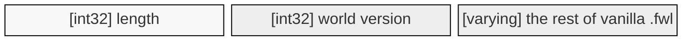
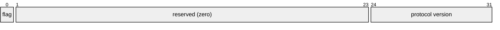
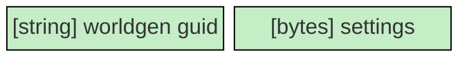

# Worldhalla

Worldhalla isn't a world generator itself; it's a framework Valheim mod writers can use to free
themselves from the tedious parts of modding world generation:
save file integration, networking and patching the game.

To the user, Worldhalla provides a way to manage per-world information about which mod generated
a particular world and what mod-specific settings it used, without the risk of loading a world with
the wrong mod setup and wrecking builds due to changed terrain.

The save file format also guarantees that a vanilla client can't accidentally load modded worlds and
wreck them the same way: vanilla sees all Worldhalla worlds as `[BAD_VERSION]`.

## Dedicated servers

A dedicated server creates the world named by `-world` when it doesn't exist yet. By default that
world is vanilla; to have a generator create it instead, pass its GUID:

```
valheim_server -world MyWorld -wh guid dev.gurebu.riverheim.stable
```

Settings for the new world are passed as a single string, whose format is up to the generator
(`IWorldGenerator.ParseCommandLineSettings`); without it the generator's defaults are used:

```
valheim_server -world MyWorld -wh guid dev.gurebu.riverheim.stable -wh settings "preset builtin.amur"
```

These options only apply to worlds being created: an existing world keeps the generator it was made
with, and the server logs a warning if that differs from the one requested. The server refuses to
start, rather than falling back to vanilla, if the GUID belongs to no installed generator, if the generator rejects the settings, or if a
world with that name exists but can't be loaded — vanilla would silently replace such a world with
a new one.

## Save file format

Worldhalla writes its world information into the game's own `.fwl` world header, using a transpiler
to patch the game's save and load methods. Similar changes are applied to `SendPeerInfo` and
`RPC_PeerInfo` to facilitate the transfer of newly added data over the network.

The game uses its own serialization machinery called `ZPackage`, which is a thin wrapper over
`BinaryWriter`. It encodes:

- `int32` / `uint32` — 4 bytes little-endian, `int64` — 8 bytes, `bool` — 1 byte
- `string` — a 7-bit-encoded length prefix followed by UTF-8
- `bytes` — an `int32` length followed by arbitrary data

The whole package is always prefixed by its length in bytes, and Worldhalla adds its data only at
the beginning of the file, so that fields the game may add later can't collide with it.

### Original .fwl file format (as of Valheim 1.0)



### Modded .fwl file format

```mermaid
block-beta
columns 5
  len["[int32] length"] hdr["[uint32] worldhalla header"] ver["[int32] world version"] payload["[bytes] worldhalla payload"] rest["[varying] the rest of vanilla .fwl"]

style len fill:#f8f8f8,stroke:#000,color:#000
style hdr fill:#c5eec7,stroke:#000,color:#000
style ver fill:#eee,stroke:#000,color:#000
style payload fill:#c5eec7,stroke:#000,color:#000
style rest fill:#eee,stroke:#000,color:#000
```



Vanilla fields are untouched and kept in their original order. Worldhalla adds a header, whose most
significant bit is always set, in front of the world version. As a result, vanilla clients reading
the header interpret it as the **signed** world version, encounter a negative number and refuse to
load.

#### Worldhalla header



Besides the modded world flag, the header currently carries only the Worldhalla protocol version in
its least significant byte, which is `0`. A change to the format takes a new version number rather
than a new meaning for an existing one, so worlds written by a newer Worldhalla are declined rather
than misread.

#### Worldhalla payload

The payload is a `ZPackage` of its own, written into the `.fwl` as one length-prefixed `bytes`
field. A tool that reads `.fwl` files but knows nothing about Worldhalla can therefore step over it
with a single length-prefixed read, without parsing anything inside.



For now it only holds the GUID of the generator that produced the world (for example, Riverheim)
and a blob of settings data that is handed off to the generator to read and write. In the future it
might also carry generator-agnostic settings like world size multipliers.

## Modding instructions

Reference `Worldhalla.API`, implement `IWorldGenerator`, and label the class:

```csharp
[BepInPlugin("dev.you.mygen", "MyGen", "1.0.0")]
[BepInDependency("dev.gurebu.worldhalla")]
public class MyPlugin : BaseUnityPlugin { }

[WorldhallaPlugin]
public class MyGenerator : IWorldGenerator
{
    public string Guid => "dev.you.mygen";
    public string Moniker => "MG";
    public string Name => "My Generator";
    public IWorldGenerator.Feature[] Features => [];

    public ISettings DefaultSettings => new MySettings();
    public ISettings DeserializeSettings(byte[] data, out string error) { ... }
    public ISettings? ParseSettings(string settings, out string error) { ... }
    public IWorldState Generate(int seed, ISettings settings) { ... }
}
```

Reference the API as compile-only and don't ship it.

### Guidelines

#### Stable output

Valheim never saves a world's baseline terrain: every chunk is regenerated from the generator each
time it loads. What it does save — objects placed when a zone was first generated, and terrain edits
stored as offsets — is only valid against the terrain it was created on. A generator must therefore
return the same output for the same seed and settings forever: across its own updates, across
platforms and across runtimes.

<!-- TODO -->

## Building

Needs the .NET 8 SDK and a local Valheim install, which `BuildTools/ValheimLibs.targets`
auto-detects from the usual Steam locations (override with `-p:ValheimDataPath=...`).

```
dotnet build Worldhalla.sln
dotnet test Worldhalla.sln
dotnet publish Worldhalla.Plugin -c Release   # builds the Thunderstore package
```

The test suite runs the transpilers over the game's real IL without launching the game, and skips
rather than fails when no Valheim install is present.
