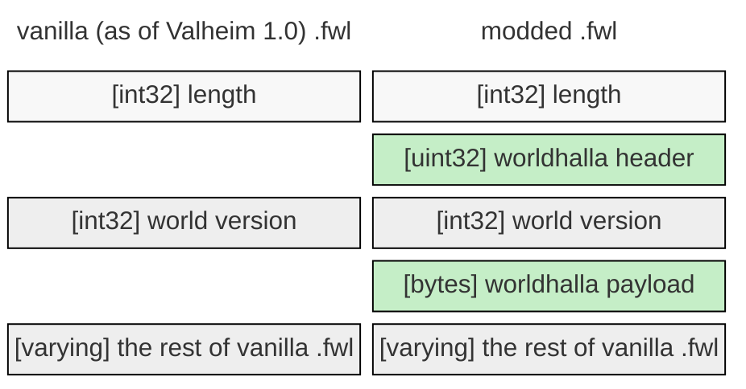
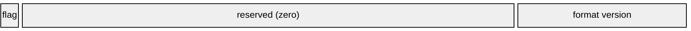
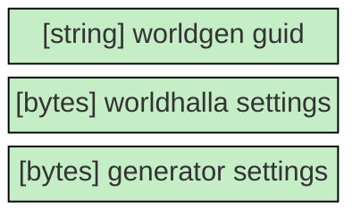
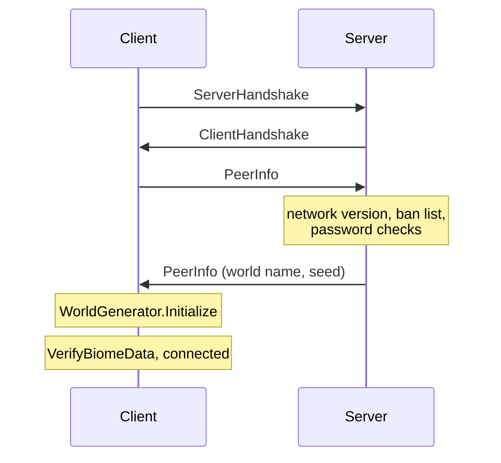
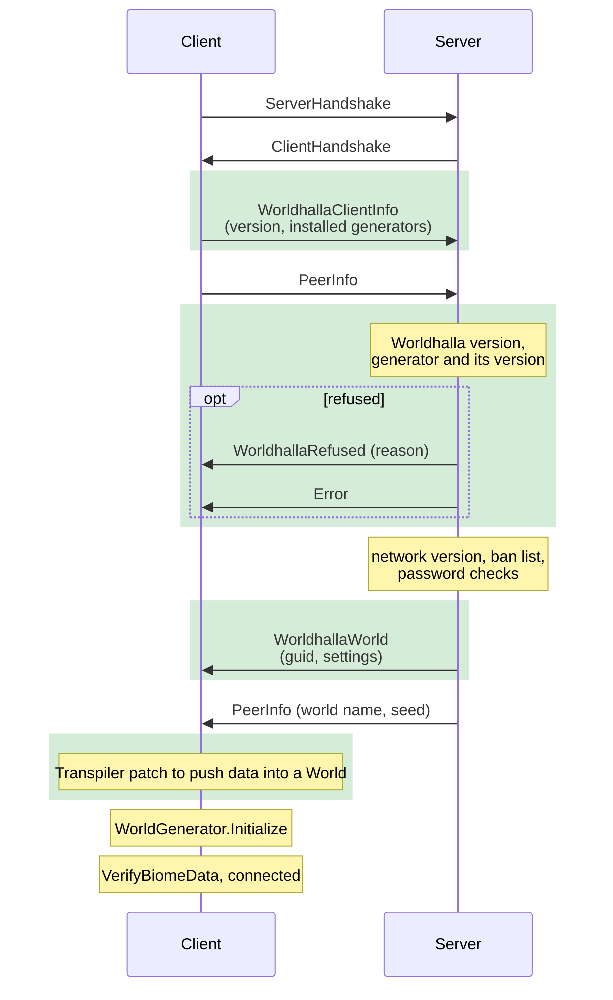

# Worldhalla

Worldhalla is a modding framework for Valheim that helps both users and mod authors to manage worlds created by
different generation algorithms. The task it aims to solve is crucial because of how Valheim's world generation
works: terrain is always generated in runtime by the game's code and should that code change, so will the terrain
while all the objects including player builds will stay in their place, potentially putting them under the ground
or into the air where they will break.

To the user, Worldhalla provides a way to manage per-world information: which mod was used to create a world and what
particular settings did it have. It makes it possible to use several worldgen mods together and makes it impossible
to load a world with the wrong mod. It also provides a number of helpful facilities and UI improvements further
described in the plugin's [README](./Worldhalla.Plugin/README.md). In the future it will also enable postprocessing
settings that are valid for any world generation.

To the mod author, Worldhalla will do the heavy lifting of patching the game to use your world generator, saving and
loading settings from the save file, properly distributing your world over the network and managing incompatibilities.
All you need to do is write the generation algorithm itself, wire it to Worldhalla's API and guarantee that generation
stays reproducible across versions with the same seeds and settings. You can find further integration details in the
API's [README](./Worldhalla.API/README.md).

Worldhalla's core patches have initially been written for
[Riverheim](https://thunderstore.io/c/valheim/p/Gurebu/Riverheim/) and thus have stood the test of time. Riverheim
itself will now be a Worldhalla plugin and won't do any game patching anymore.

Across the board the design vision is "if Valheim had an official world generation modding API, it would have been
Worldhalla".

## Key ideas

### Hold a registry of all world generators that mods can add to

To add to the registry a mod has to use an attribute and implement an interface, very much like a BepInEx plugin would:

```csharp
[WorldhallaPlugin("com.example.generatorsample")]
public class Generator : IWorldGenerator { ... }
```

### Save the world generation metadata straight into the .fwl world file

Key idea is to insert ZPackage writes with a transpiler that mark the world as modded (add a marker that makes it known
to worldhalla and at the same time unloadable for vanilla) and save all the necessary meta information. World generators
each get a GUID that is part of this meta information and helps discern which world is which. Since we're only writing
data to the beginning of the file, modded worlds easily survive Valheim patches that add new fields to the end.

### Make sure every game instance of `World` comes with enriched information about worldgen

Once we extract the extra fields from the .fwl ZPackage, we inject code to store this information "into" the instance.
Fields can't be added to the game's types at runtime, so we use a ConditionalWeakTable (which stores values associated with an object as
long as the object is alive) paired with get/set extensions on `World` to get as close to additional fields as possible.
Among these extra fields is the GUID of the generator and the generator instance that corresponds to it.

### Patch methods of `WorldGenerator` to look into `World` and replace preprocessing with our own

The game creates its `WorldGenerator` through the static `WorldGenerator.Initialize(World)`, whose constructor calls
`Pregenerate`, vanilla's blocking preprocessing of the world (placing rivers). For a Worldhalla world we replace it with
a method that runs the `World`'s generator and keeps the resulting world state in a `ConditionalWeakTable` similar to
the above.

### Replace calls to `WorldGenerator` with our own

`GetBiome`, `GetBiomeHeight` and a few others get patched by replacement methods which call into the world state to 
effectively replace the generator and make new terrain and biomes visible to the game.

### Transfer world metadata over the net

We achieve this by registering new handshake RPCs and transferring the metadata through them. A client then injects code
into its handling of the server's `PeerInfo`, before the game initializes its `WorldGenerator`, to populate the new
extension fields with the metadata and run the generator, whose result `Pregenerate` picks up.

## Save file format

The game uses its own serialization machinery called `ZPackage`, which is a thin wrapper over
`BinaryWriter`. It encodes:

- `int32` / `uint32` — 4 bytes little-endian, `int64` — 8 bytes, `bool` — 1 byte
- `string` — a 7-bit-encoded length prefix followed by UTF-8
- `bytes` — an `int32` length followed by arbitrary data

The whole package is always prefixed by its length in bytes.

### .fwl file layout

If you're working with .fwl files directly (maybe as a part of a dedicated server platform), you might be interested in
the exact data layout to support Worldhalla worlds:



Vanilla fields are untouched and kept in their original order. Worldhalla adds a header word right after package length
with its most significant bit set. As a result, an unmodded game loading the file interprets the header as the
**signed** world version, encounters a negative number and refuses to load.

#### Worldhalla header



The header is drawn most significant bit first: the flag is bit 31 and the format version is the low
byte. Besides the modded world flag, the header currently carries only the Worldhalla format version in
its least significant byte, which is `0`. A change to the format takes a new version number rather
than a new meaning for an existing one, so worlds written by a newer Worldhalla are declined rather
than misread.

#### Worldhalla payload

The payload is a `ZPackage` of its own, written into the `.fwl` as one length-prefixed `bytes`
field. A tool that reads `.fwl` files but knows nothing about Worldhalla can therefore step over it
with a single length-prefixed read, without parsing anything inside.



It holds the GUID of the generator that produced the world (for example, Riverheim), a blob of
Worldhalla's own generator-agnostic settings, and a blob of settings data that is handed off to the
generator to read and write. Worldhalla's settings blob is empty for now; it is reserved for
settings like world size multipliers. The generator's blob may take at most 64 KiB; settings
describe a world rather than carry its data.

## Networking

Worldhalla adds three new RPCs to the protocol:

- `WorldhallaClientInfo` is responsible for the server getting info on which version of the plugin the client is running and what generators it has installed.
- `WorldhallaWorld` is the transport RPC for the server world to the client.
- `WorldhallaRefused` is the refusal RPC with enough metadata to get coherent error messages.

The reason data isn't being sent as extra payload is compatibility with vanilla peers: there's no real reason to be
incompatible when the server runs a vanilla world, so we make that vanilla peers still understand the part of the
protocol that's visible to them. Unknown RPCs aren't an error, they're just discarded, which makes this possible.

Compatibility is decided per world. On a vanilla world, modded and unmodded peers mix freely. On a Worldhalla world, 
the server admits only clients running the same major and minor Worldhalla version and the world's generator at exactly
the same version. A client generates the world while connecting, with its main thread blocked, 
so Worldhalla answers the server's pings meanwhile to keep a long generation from timing the client out.

### Vanilla connection



### Worldhalla world connection



## Building

Needs the .NET 8 SDK and a local Valheim install, which `BuildTools/ValheimLibs.targets`
auto-detects from the usual Steam locations (override with `-p:ValheimDataPath=...`).

```
dotnet build Worldhalla.sln
dotnet test Worldhalla.sln
dotnet publish Worldhalla.Plugin -c Release   # builds the Thunderstore package
```
The test suite runs the transpilers over the game's real IL without launching the game, and skips
rather than fails when no Valheim install is present.
