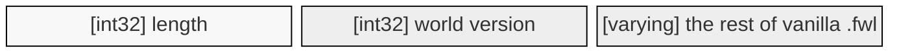
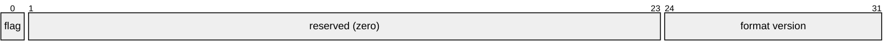
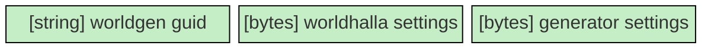

# Worldhalla

Worldhalla is a modding framework for Valheim that helps both users and mod authors to manage worlds created by
different generation algorithms. The task it aims to solve is crucial because of how Valheim's world generation
works: terrain is always generated in runtime by the game's code and should that code change, so will the terrain
while all the objects including player builds will stay in their place, potentially putting them under the ground
or into the air where they will break.

To the user, Worldhalla provides a way to manage per-world information: which mod was used to create a world and what
particular settings did it have. It makes it possible to use several worldgen mods together and makes it impossible
to load a world with the wrong mod. It also provides a number of helpful facilities and UI improvements further
described in the plugin's [README](./Worldhalla.Plugin/README.md). In the future it will also enable postprocessing
settings that are valid for any world generation.

To the mod author, Worldhalla will do the heavy lifting of patching the game to use your world generator, saving and
loading settings from the save file, properly distributing your world over the network and managing incompatibilities.
All you need to do is write the generation algorithm itself, wire it to Worldhalla's API and guarantee that generation
stays reproducible across versions with the same seeds and settings. You can find further integration details in the
API's [README](./Worldhalla.API/README.md).

Worldhalla's core patches have initially been written for
[Riverheim](https://thunderstore.io/c/valheim/p/Gurebu/Riverheim/) and thus have stood the test of time. Riverheim
itself will now be a Worldhalla plugin and won't do any game patching anymore.

Across the board the design vision is "if Valheim had an official world generation modding API, it would have been
Worldhalla".

## Plugin architecture

## Save file format

Worldhalla writes its world information into the game's own `.fwl` world header, using a transpiler
to patch the game's save and load methods. Similar changes are applied to `SendPeerInfo` and
`RPC_PeerInfo` to facilitate the transfer of newly added data over the network.

The game uses its own serialization machinery called `ZPackage`, which is a thin wrapper over
`BinaryWriter`. It encodes:

- `int32` / `uint32` — 4 bytes little-endian, `int64` — 8 bytes, `bool` — 1 byte
- `string` — a 7-bit-encoded length prefix followed by UTF-8
- `bytes` — an `int32` length followed by arbitrary data

The whole package is always prefixed by its length in bytes, and Worldhalla adds its data only at
the beginning of the file, so that fields the game may add later can't collide with it.

### Original .fwl file format (as of Valheim 1.0)



### Modded .fwl file format

```mermaid
block-beta
columns 5
  len["[int32] length"] hdr["[uint32] worldhalla header"] ver["[int32] world version"] payload["[bytes] worldhalla payload"] rest["[varying] the rest of vanilla .fwl"]

style len fill:#f8f8f8,stroke:#000,color:#000
style hdr fill:#c5eec7,stroke:#000,color:#000
style ver fill:#eee,stroke:#000,color:#000
style payload fill:#c5eec7,stroke:#000,color:#000
style rest fill:#eee,stroke:#000,color:#000
```



Vanilla fields are untouched and kept in their original order. Worldhalla adds a header, whose most
significant bit is always set, in front of the world version. As a result, vanilla clients reading
the header interpret it as the **signed** world version, encounter a negative number and refuse to
load.

#### Worldhalla header



Besides the modded world flag, the header currently carries only the Worldhalla format version in
its least significant byte, which is `0`. A change to the format takes a new version number rather
than a new meaning for an existing one, so worlds written by a newer Worldhalla are declined rather
than misread.

#### Worldhalla payload

The payload is a `ZPackage` of its own, written into the `.fwl` as one length-prefixed `bytes`
field. A tool that reads `.fwl` files but knows nothing about Worldhalla can therefore step over it
with a single length-prefixed read, without parsing anything inside.



It holds the GUID of the generator that produced the world (for example, Riverheim), a blob of
Worldhalla's own generator-agnostic settings, and a blob of settings data that is handed off to the
generator to read and write. Worldhalla's settings blob is empty for now; it is reserved for
settings like world size multipliers. The generator's blob may take at most 64 KiB; settings
describe a world rather than carry its data.

<!-- TODO -->

## Building

Needs the .NET 8 SDK and a local Valheim install, which `BuildTools/ValheimLibs.targets`
auto-detects from the usual Steam locations (override with `-p:ValheimDataPath=...`).

```
dotnet build Worldhalla.sln
dotnet test Worldhalla.sln
dotnet publish Worldhalla.Plugin -c Release   # builds the Thunderstore package
```

The test suite runs the transpilers over the game's real IL without launching the game, and skips
rather than fails when no Valheim install is present.
