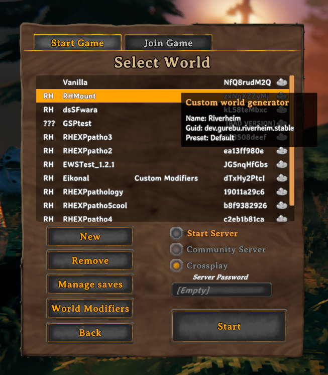
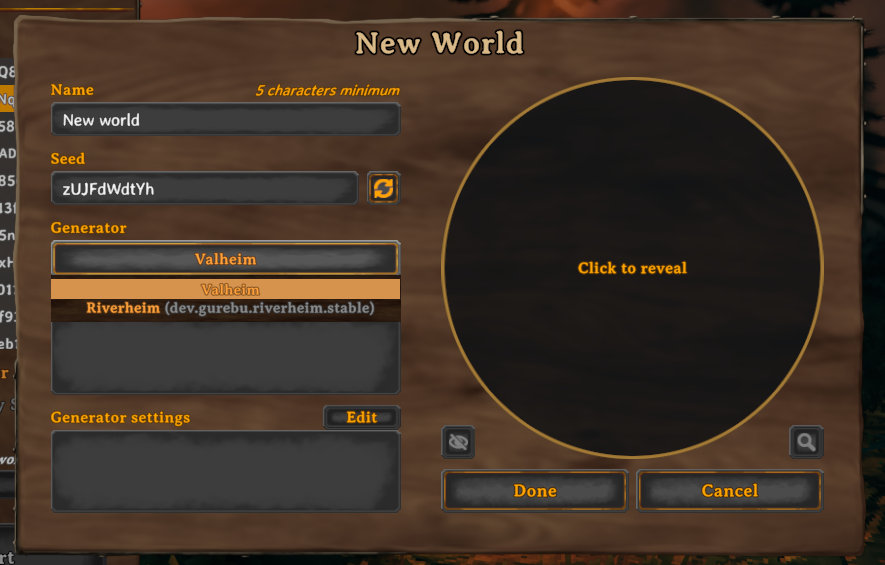
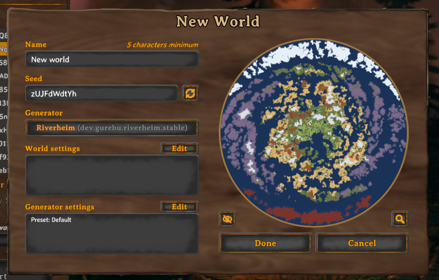
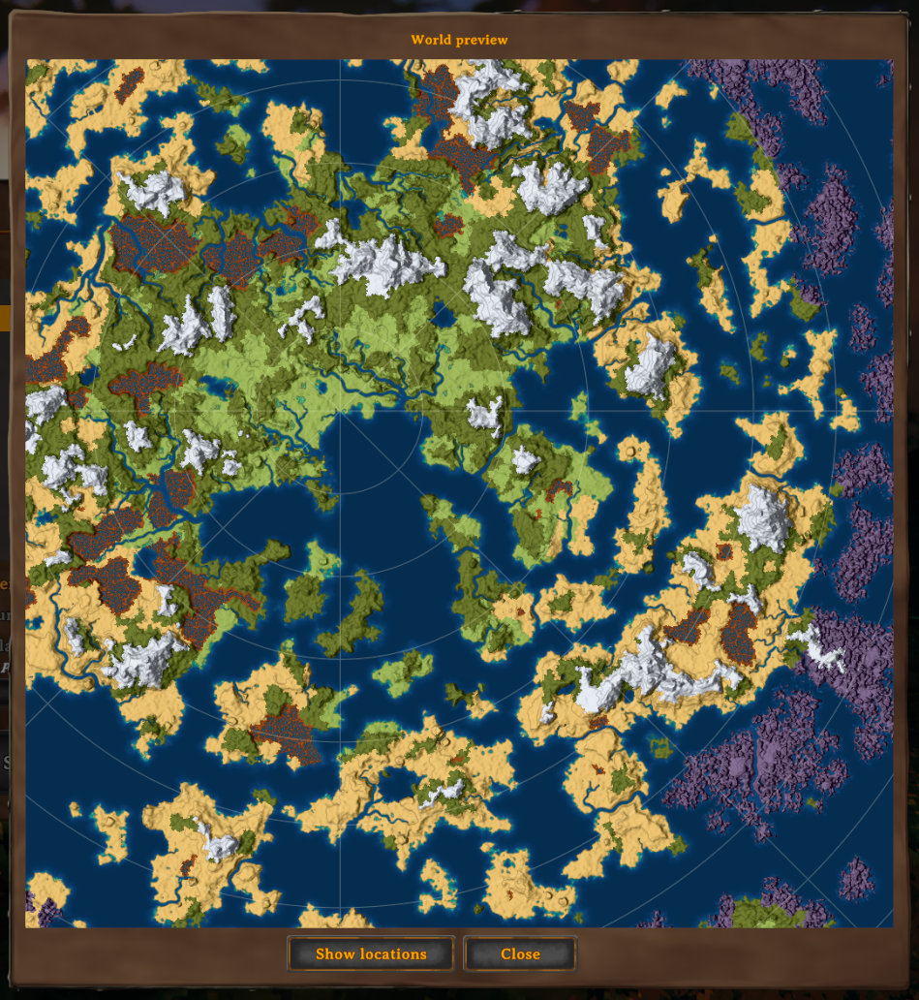
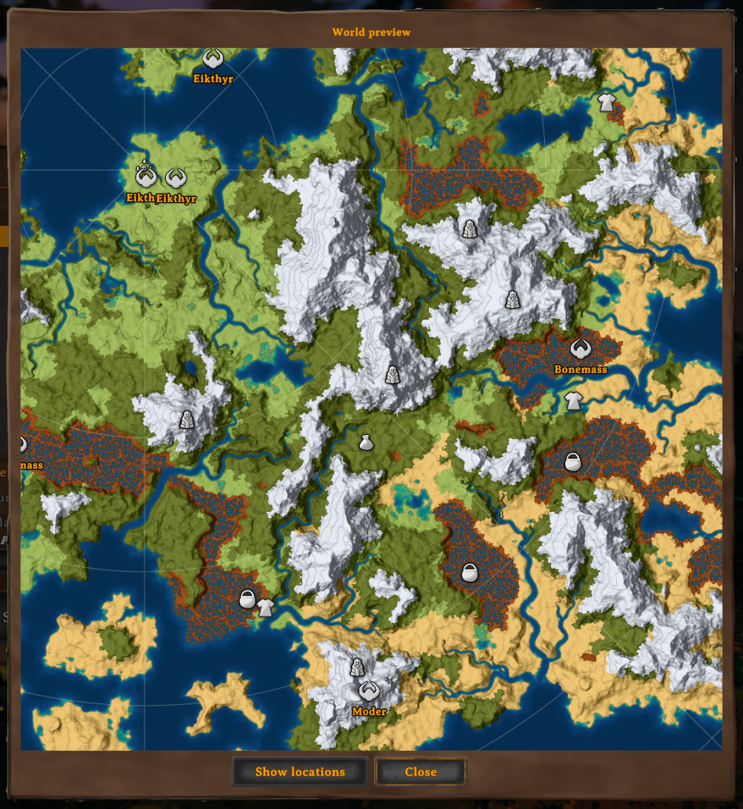

# Worldhalla

Worldhalla is a world manager and modding framework for Valheim. Its primary purpose is to provide the users with a
simple and danger-free way to manage their world generation mods and the worlds that have been created with those mods;
and also provide mod creators with an API to plug their generators into so that they don't have to deal with saving and
loading, networking or deal with compatibility issues. As long as modded generator settings are applied per world,
you can have as many of them installed as you want without ever getting conflicts.

Worldhalla has been born from the patching code of [Riverheim](https://thunderstore.io/c/valheim/p/Gurebu/Riverheim/)
and Riverheim is the first mod to support the API.

## Features

- Manage worlds created by different world generators alongside vanilla worlds:



- New world creation GUI with support for custom world generators:



- Preview worlds before creation:



- Detailed preview for terrain and select locations:

| Detailed preview                                      | Location preview                                        |          
|-------------------------------------------------------|---------------------------------------------------------|
|  |  |

## Installation

Install with a mod manager of your choice or put `Worldhalla.dll` into your `BepInEx/plugins` folder manually.

Non-vanilla worlds created by Worldhalla won't be playable without both Worldhalla and the generation mod for each
particular world. This is necessary both on the server and on every client.

## Dedicated servers

A dedicated server creates the world named by `-world` when it doesn't exist yet. By default, that
world is vanilla; to have a generator create it instead, pass its GUID:

```
valheim_server -world MyWorld -wh guid <generator-guid>
```

Settings for the new world are passed as a single string, whose format is up to the generator;
without it the generator's defaults are used:

```
valheim_server -world MyWorld -wh guid <generator-guid> -wh settings "<generator-settings>"
```

These options only apply to worlds being created: an existing world keeps the          
generator it was made with, and -wh options are ignored for it (the server logs a warning). The server refuses to
start, rather than falling back to vanilla, if the GUID belongs to no installed generator, if the generator rejects
the settings, or if a world with that name exists but can't be loaded.

## Mod compatibility

- Broad compatibility with mods that don't touch terrain and biome generation (location mods are fine).
- **Location Placement Accelerator** is compatible, but location preview is disabled in all modes but Vanilla.
- Incompatible with mods that change the world creation window i.e. UI overhaul mods. Worldhalla requires this window to work.
- Partially compatible with mods that change the world list window. You can use the config to disable Worldhalla's changes to this window.
- Limited compatibility with **Expand World Size** (stretch only).
- Incompatible (for now) with **Better Continents**.

## For mod authors

If you're interested in rolling your own world generator for Worldhalla, there's a modding API, instructions and a sample
project in [Worldhalla's GitHub repository](https://github.com/Gurebu/worldhalla).

You can also ask questions and suggest improvements in [Riverheim's discord server](https://discord.gg/ES3J7mu6kW).
